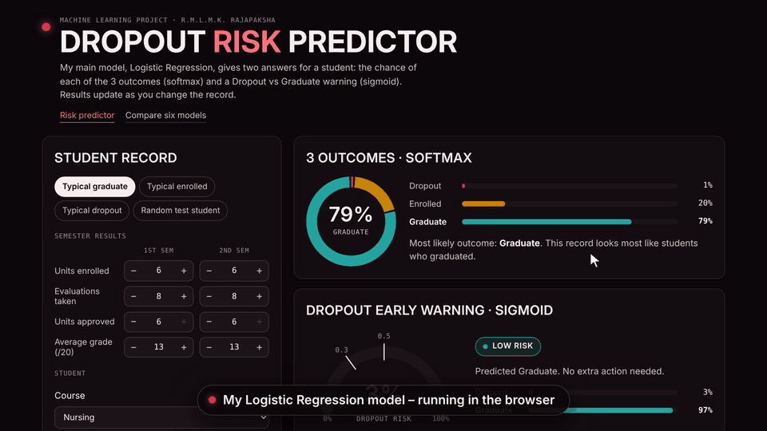
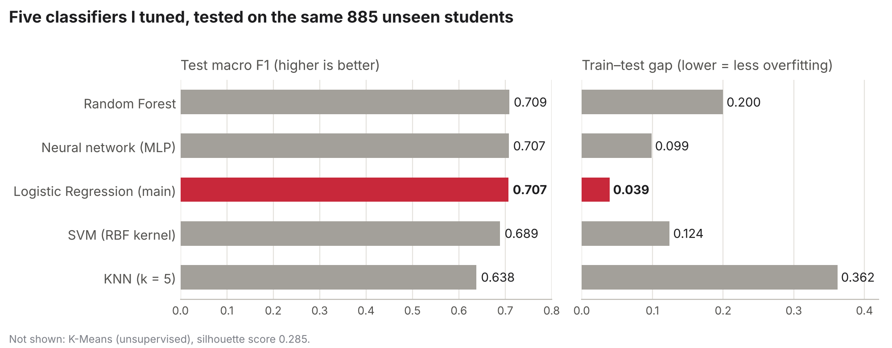
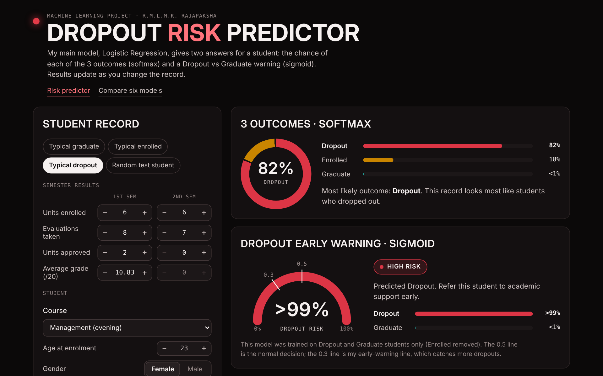
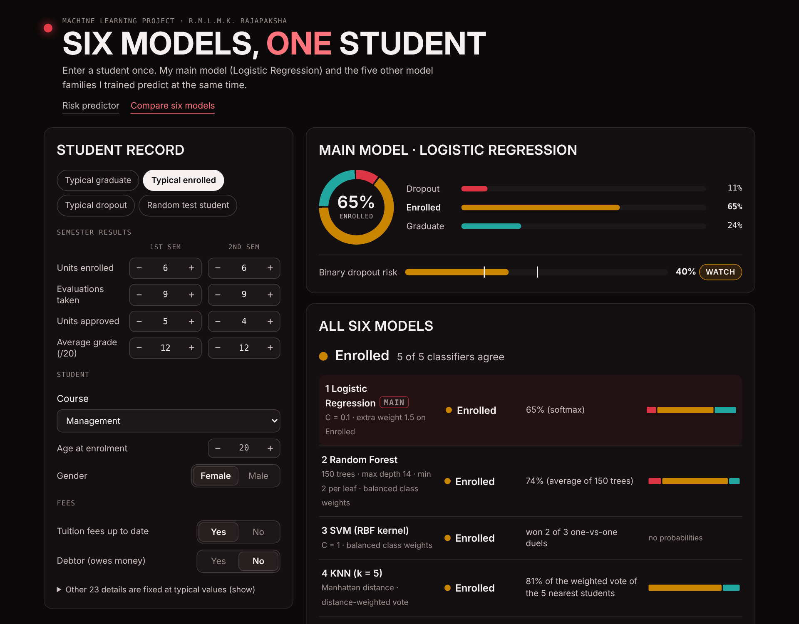

# Student Dropout Prediction with Machine Learning

Can we tell early which university students are likely to **drop out**, **stay enrolled** or **graduate**? In this project I prepare 4,424 real student records, train and tune six model families, and ship the final model as an interactive web demo that runs entirely in the browser.

**[▶ Try the live demo](https://lowaga2003-code.github.io/student-dropout-prediction/)** · [Six models side by side](https://YOUR-GITHUB-USERNAME.github.io/student-dropout-prediction/compare.html)

`Python` `pandas` `scikit-learn` `NumPy` `Matplotlib` `JavaScript` `HTML/CSS`



## Highlights

- **End-to-end pipeline:** 36 raw features + 4 engineered features → standard scaling and one-hot encoding → 110 model-ready features. The train/test split is done *before* any fitting, so no information leaks from the test set.
- **Main model – Logistic Regression:** a 3-class model (softmax) and a binary Dropout-vs-Graduate early-warning model (sigmoid), tuned with GridSearchCV and stratified 5-fold cross-validation, plus experiments with different pre-processing.
- **Fair comparison:** six model families – Logistic Regression, Random Forest, SVM, KNN, a neural network (MLP) and K-Means – tuned the same way and tested on the same 885 unseen students.
- **Web demo with no server:** the trained models are exported to JSON and re-implemented in JavaScript. Their predictions match scikit-learn for all 885 test students.

## Results

| Model | Best settings (GridSearchCV) | CV macro F1 | Test accuracy | Test macro F1 | ROC-AUC | Train–test gap |
|---|---|---|---|---|---|---|
| **Logistic Regression (main)** | **C = 0.1, extra weight 1.5 on Enrolled** | **0.717** | **0.763** | **0.707** | **0.888** | **0.039** |
| Random Forest (150 trees) | max depth 14, min 2 per leaf, balanced | 0.720 | 0.751 | 0.709 | 0.890 | 0.200 |
| Neural network (MLP) | 64 → 32 neurons, alpha 0.01 | 0.699 | 0.768 | 0.707 | 0.875 | 0.099 |
| SVM | RBF kernel, C = 1, balanced | 0.719 | 0.729 | 0.689 | – | 0.124 |
| KNN | k = 5, Manhattan distance, distance-weighted | 0.655 | 0.731 | 0.638 | 0.827 | 0.362 |
| K-Means (unsupervised) | k = 3 (elbow + silhouette) | silhouette 0.285 | | | | |



- **Macro F1 is the main metric** because the classes are imbalanced (Enrolled is only 18% of students). Accuracy alone would hide a model that ignores the Enrolled class.
- Random Forest, the neural network and Logistic Regression finish **within 0.002 macro F1** of each other. **I chose Logistic Regression** because it has by far the smallest train–test gap (0.039 against 0.200 for Random Forest) and its weights can be explained to university staff.
- **Early-warning model (Dropout vs Graduate):** accuracy 0.902, Dropout F1 0.873, ROC-AUC 0.945. Lowering the decision threshold from 0.5 to 0.3 catches 90% of dropouts (recall 0.863 → 0.901), at the cost of more false alarms (precision 0.884 → 0.800).
- **K-Means** never sees the outcomes, yet one of its three clusters is 82% dropouts: students with low approval rates, low grades and more failed units.

## What I learned

- **Accuracy can mislead.** Tuning (C = 0.1 and extra weight 1.5 on Enrolled) raised Enrolled recall from 0.41 to 0.53 and macro F1 from 0.705 to 0.707, while accuracy *fell* from 0.776 to 0.763.
- **Look at overfitting, not only the score.** Three models tied on test macro F1, but their train–test gaps ranged from 0.039 to 0.200. KNN with distance weights scores a perfect 1.0 on its own training data – a sign of memorising, not learning.
- **Not every idea helps.** My engineered features separate the classes clearly (2nd-semester approval rate: 0.29 for dropouts, 0.90 for graduates), but removing them did not hurt Logistic Regression (macro F1 0.714 without them). The linear model already gets this information from the semester columns.
- **Shipping matters.** Re-implementing the models in JavaScript, and testing them against Python, turned the notebooks into something anyone can try.

## Interactive demo

| Risk predictor | Six models, one student |
|---|---|
| Logistic Regression: the probability of each outcome and a dropout-risk gauge with Low / Watch / High levels. | The same student is scored by all six models, with a majority vote and a table of their test results. |





The forms show 13 key inputs (semester results, course, age, gender and fees). The other inputs are filled with typical values from the training data.

## Project structure

```
student-dropout-prediction/
├── 1_data_preparation.ipynb     # data checks, 4 engineered features, split, scaling + encoding → 110 features
├── 2_logistic_regression.ipynb  # main model: 3-class + early-warning, tuning, threshold, pre-processing experiments
├── 3_model_comparison.ipynb     # Random Forest, SVM, KNN, neural network and K-Means against Logistic Regression
├── data/
│   ├── raw/                     # original UCI dataset (4,424 students)
│   └── processed/               # made by notebook 1: train (3,539) and test (885) sets
├── models/                      # saved models (made by the notebooks)
├── results/                     # model comparison table
├── images/                      # charts and screenshots
├── webapp/                      # exports the models to JSON and builds the demo pages
└── docs/                        # the built demo (GitHub Pages)
```

## How to run

```bash
git clone https://github.com/lowaga2003-code/student-dropout-prediction.git
cd student-dropout-prediction
pip install -r requirements.txt
jupyter notebook        # run the notebooks in order: 1 → 2 → 3
```

To rebuild the web demo after running the notebooks, see [`webapp/README.md`](webapp/README.md).

## Limitations and responsible use

- The data come from one higher-education institution in Portugal, so the models should be retrained on local data before being used anywhere else.
- A prediction should start a conversation about support, not make a decision about a student. The inputs include age, gender and financial details, so errors should be checked across student groups before any real use.

## Dataset

Realinho, V., Vieira Martins, M., Machado, J., & Baptista, L. *Predict Students' Dropout and Academic Success* [Dataset]. UCI Machine Learning Repository. <https://archive.ics.uci.edu/dataset/697> (CC BY 4.0).
Background paper: Realinho et al. (2022), "Predicting Student Dropout and Academic Success", *Data* 7(11), 146.

## Acknowledgements

AI coding assistants were used to help write and debug the code and to build the web demo.

## License

Code: [MIT](LICENSE). Dataset: CC BY 4.0, as published by the UCI Machine Learning Repository.
